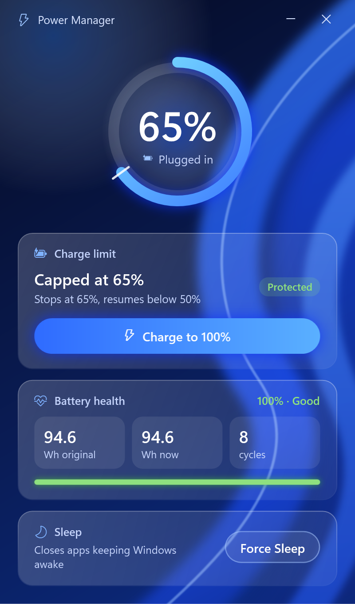

# Power Manager

One small window for your Windows 11 laptop's battery:

- **Charge limit**: cap charging at 65% while you're docked, or charge to 100% before you go out. Switches immediately, with no reboot (Dell laptops, via Dell Command | Configure).
- **Battery health**: the battery's original (design) capacity, its full charge capacity today, and how many charge cycles it has completed.
- **Hibernate now**: saves everything you have open and powers the laptop fully off, so it can't heat up in a bag. Nothing is closed; it all comes back when you turn the laptop on.

<p align="center"></p>

Battery health and Hibernate now work on any Windows 11 laptop. The charge limit needs a Dell laptop out of the box; on other brands that card says "Not available" until you plug in your vendor's tool (see [Other laptop brands](#other-laptop-brands)).

## Compatibility

| | |
|---|---|
| Windows | Windows 11, all releases (21H2 to 25H2). Developed and tested on 25H2 (build 26200). |
| Runtime | Built-in Windows PowerShell 5.1 and WPF (.NET Framework 4.8). Nothing to download. PowerShell 7 also works. |
| Charge limit | Dell laptops with [Dell Command \| Configure](https://www.dell.com/support/kbdoc/en-us/000178000/dell-command-configure) installed and no BIOS admin password set. |
| Battery health | Any laptop whose battery driver reports capacity and cycle count (almost all). Shows "--" for any value the battery doesn't report. |
| Hibernate now | Any laptop with hibernate turned on (the default on most laptops). |

Everything the app uses is a long-standing Windows interface, so Windows updates shouldn't break it. It doesn't use the HTML battery report, Store APIs, or anything that needs a particular Windows 11 build. The two Windows 11-only touches, dark window frame and rounded corners, are simply skipped by builds that don't support them.

## Tested on a real laptop

Version 1.0.0 was tested by hand on a Dell Pro Max 16 Premium with Windows 11 Pro 25H2, in daily use on a Thunderbolt dock and in a backpack. The hibernate results come from Windows' own event logs; the others from direct checks on the installed app:

| Test | Result |
|---|---|
| Install from the release zip with `Install.cmd` | Pass. One admin prompt, then the shortcut opens the window with none. |
| Charge limit reading (Dell Command \| Configure) | Pass. Showed the real BIOS setting, capped at 65%. |
| Battery health | Pass. Matched Windows' own WMI values exactly (94,559 mWh, 8 cycles). |
| **Hibernate now** button | Pass. Fully off (hibernate, S4) 26 s after the click, stayed off 15 min, and the session came back. |
| Closing the lid, then carrying it in a backpack | Pass. Fully off 25 s after closing the lid, stayed off for 50 min in the bag, and the session came back on battery. |

Before the fix, the same laptop spent 0% of its docked standby time in the low-power state, which is why it stayed hot. The full record, what wasn't tested yet, and commands to check the same things on your laptop are in [docs/TESTING.md](docs/TESTING.md).

## Install

1. Download `PowerManager.zip` from the [latest release](https://github.com/e1-rahabok/PowerManager/releases/latest) and unzip it (right-click > **Extract All**).
2. Dell only: install [Dell Command | Configure](https://www.dell.com/support/kbdoc/en-us/000178000/dell-command-configure) if you want the charge limit.
3. Double-click **Install.cmd**. If Windows shows "Windows protected your PC", click **More info > Run anyway**.
4. Click **Yes** on the admin prompt.

From a PowerShell prompt you can run `powershell -ExecutionPolicy Bypass -File Install.ps1` instead.

The installer:

1. Copies `PowerManager.ps1` (and `background.png`/`.jpg` if you added one) to `C:\Program Files\PowerManager`, where only admins can change it.
2. Registers an on-demand scheduled task, `\PowerManager\Window`, that runs as you with highest privileges.
3. Creates a desktop shortcut, **Power Manager**, that starts that task.
4. Removes the earlier Battery Charge setup (its task, shortcut and Program Files folder), if present.

After that, double-click **Power Manager**. There's **no UAC prompt**, because the shortcut starts the pre-approved task instead of asking for admin rights each time.

Run `Install.cmd` again after any change to the script or background, or to update to a new release.

## Using it

- **Ring gauge**: current battery level and whether you're plugged in. When a charge limit is set, a white tick marks where charging stops.
- **Charge limit**: shows whether charging is capped. The button switches between **Charge to 100%** and **Cap at 65%**. The change takes effect immediately.
- **Battery health**: original capacity and full charge capacity in watt-hours, charge cycles, and health (full charge ÷ original). Health of 80% or more shows as Good, 60–79% as Worn, below 60% as Replace soon.
- **Hibernate now**: saves your open apps and documents to disk and powers the laptop fully off. It can't be kept awake by apps or drivers, so it stays cool. Nothing is closed: when you turn the laptop on, everything is back as you left it. Turning on takes about 10-20 seconds instead of being instant.

Press **Esc** or the close button to close the window. Task Scheduler ends the window if it's left open for more than an hour.

## Stop the laptop getting hot in a bag

Many Windows 11 laptops use Modern Standby instead of classic sleep. In Modern Standby the laptop is meant to drop to very low power, but an app, a driver or a dock can keep it running at full power with the lid closed. That's how a laptop ends up hot after hours in a backpack.

Hibernate doesn't have that problem: the laptop is fully off. To make **closing the lid** hibernate (on battery and when plugged in), run this once in PowerShell:

```powershell
powercfg /setacvalueindex SCHEME_CURRENT SUB_BUTTONS LIDACTION 2
powercfg /setdcvalueindex SCHEME_CURRENT SUB_BUTTONS LIDACTION 2
powercfg /setactive SCHEME_CURRENT
```

To go back to sleep on lid close, run the same commands with `1` instead of `2`. You can also change it in **Control Panel > Power Options > Choose what the closing the lid does**.

To check whether standby really reaches low power on your laptop, run `powercfg /sleepstudy` in an admin PowerShell and open the report it saves.

## How it works

| Feature | Source |
|---|---|
| Battery level | `Win32_Battery` (WMI) |
| Original capacity, full charge capacity, cycles | The battery driver itself, via `IOCTL_BATTERY_QUERY_INFORMATION`. This is the same data `powercfg /batteryreport` reads, but it takes a few milliseconds instead of generating an HTML file, and it needs no admin rights. Multiple batteries are added together. |
| Charge limit | `cctk.exe --PrimaryBattChargeCfg` (Dell Command \| Configure) |
| Hibernate now | `shutdown /h` |

The window needs admin rights for `cctk.exe`. The scheduled task provides them without a prompt.

## Customize

All settings are near the top of `PowerManager.ps1`. Edit the file in the repository, then run `Install.ps1` again.

### Charge limit percentages

The defaults are: stop at 65%, resume below 50%. Change the defaults of `-Stop` and `-Start` in the `param(...)` block:

```powershell
[ValidateRange(50, 95)]  [int]$Start = 50,
[ValidateRange(55, 100)] [int]$Stop = 65,
```

Dell's limits: `Start` 50–95, `Stop` 55–100, and `Stop` at least 5 higher than `Start`.

### Colours

Change the `$Theme` table. Colours are `#RRGGBB`, or `#AARRGGBB` with transparency.

```powershell
$Theme = @{
    Bg1 = '#040A22'; Bg2 = '#0A1C55'; Bg3 = '#0B2C86'          # background gradient
    Ribbon1 = '#1A4DFF'; Ribbon2 = '#3F8CFF'; Ribbon3 = '#5BA3FF'; RibbonLine = '#9CC4FF'
    Ring1 = '#7CE3FF'; Ring2 = '#3D7BFF'                       # battery ring
    Accent1 = '#2F6BFF'; Accent2 = '#5AB0FF'; Glow = '#3D7BFF' # main button
    ...
}
```

For example, a purple look: `Bg2 = '#2A0F55'`, `Bg3 = '#4B1A8A'`, `Ribbon1 = '#7A3CFF'`, `Ribbon2 = '#A770FF'`, `Ring2 = '#A770FF'`, `Accent1 = '#7A3CFF'`, `Accent2 = '#B58CFF'`, `Glow = '#7A3CFF'`.

### Background image

Put an image named `background.png` or `background.jpg` in the repository folder and run `Install.ps1` again. It's drawn over the ribbons at 35% opacity and cropped to fill the window. A dark image of about 800 × 1400 pixels works best. Delete it and reinstall to go back to the default.

### Other laptop brands

The charge limit lives in two functions. Replace them with your vendor's tool and the card works as on a Dell:

- `Get-ChargeCfg`: return `Custom:<start>-<stop>` when a limit is set, or `Standard` when charging to 100%.
- `Set-ChargeMode`: apply `Full` or `Limit`, and throw an error if it fails.

Also set `$cctk` to anything non-empty (for example the path to your vendor's tool) so the card is shown.

Most vendors expose the battery charge setting through a BIOS configuration tool or WMI interface, for example HP's Client Management Script Library (`Set-HPBIOSSettingValue`) or Lenovo's WMI BIOS interface (`Lenovo_SetBiosSetting`). Setting names and allowed values differ by model, so check your vendor's documentation for your laptop.

## Command line

From any PowerShell prompt. The script asks for UAC itself if needed.

```powershell
powershell -ExecutionPolicy Bypass -File PowerManager.ps1 -Mode Window
powershell -ExecutionPolicy Bypass -File PowerManager.ps1 -Mode Status
powershell -ExecutionPolicy Bypass -File PowerManager.ps1 -Mode Limit -Start 50 -Stop 65
powershell -ExecutionPolicy Bypass -File PowerManager.ps1 -Mode Full
powershell -ExecutionPolicy Bypass -File PowerManager.ps1 -Mode Toggle
```

`Status` shows the charge setting and battery health. `Full`, `Limit` and `Toggle` need Dell Command | Configure. Add `-Quiet` to skip the message boxes.

## Troubleshooting

- **The shortcut shows "Could not start the Power Manager task".** Run `Install.ps1` again.
- **Charge limit says "Not available" on a Dell.** Install Dell Command | Configure. If it's installed, check that `cctk.exe` is under `Program Files (x86)\Dell\Command Configure\X86_64` or `Program Files\Dell\Command Configure\X86_64`.
- **Changing the charge limit fails.** `cctk.exe` refuses changes when a BIOS admin password is set. The error message shows its output.
- **Battery health shows "--".** The battery driver doesn't report that value. Some batteries don't report cycle counts.
- **External monitors on a Thunderbolt dock don't come back after wake or hibernate.** This is a known issue under investigation, and it isn't caused by Power Manager. See [docs/KNOWN-ISSUES.md](docs/KNOWN-ISSUES.md) for the analysis and a way to reset the Thunderbolt controller without restarting.

## To do

- [ ] Find the cause of external monitors not being detected through a Thunderbolt dock after wake or hibernate. A controller test is running. See [docs/KNOWN-ISSUES.md](docs/KNOWN-ISSUES.md#next-steps).
- [ ] Add a **Reset dock** button that restarts the dock's Thunderbolt controller, if the reset command proves to work.
- [ ] Re-test switching the charge limit from the new window (see [docs/TESTING.md](docs/TESTING.md#not-yet-tested-by-hand)).

## Uninstall

In an elevated PowerShell:

```powershell
Unregister-ScheduledTask -TaskPath '\PowerManager\' -TaskName Window -Confirm:$false
Remove-Item "$env:ProgramFiles\PowerManager" -Recurse -Force
Remove-Item "$([Environment]::GetFolderPath('Desktop'))\Power Manager.lnk"
```

## License

[MIT](LICENSE). Free to use, change and share, including commercially, as long as the copyright notice is kept.
